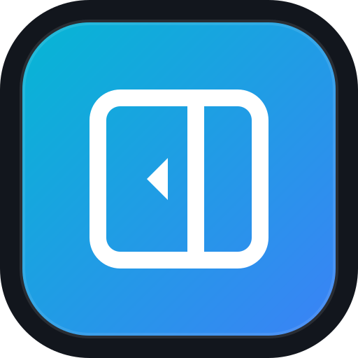

<div align="center">



# 🪟 Barra Lateral Windows (Floating Sidebar)

**Barra lateral flutuante para Windows 10/11 — lançada com um toque, fixada na borda da tela, construída em Rust + Tauri v2.**

[-orange?style=for-the-badge&logo=windows&logoColor=white)](https://github.com/Blastoles/Barra_Lateral_Windows/releases/download/nightly-dev/BarraLateral_0.2.0_x64-setup.exe)
[](https://github.com/Blastoles/Barra_Lateral_Windows/releases/download/nightly-dev/BarraLateral_0.2.0_x64_en-US.msi)
[](https://github.com/Blastoles/Barra_Lateral_Windows/actions/workflows/release.yml)

[](https://tauri.app)
[](https://www.rust-lang.org)
[](https://www.microsoft.com/windows)
[](LICENSE)

[📥 Download Direto](#-instalação-e-download) •
[✨ Funcionalidades](#-funcionalidades) •
[🧱 Stack Tecnológico](#-stack-tecnológico) •
[🌐 English Summary](#-english-summary)

</div>

---

## 📖 Sobre

**Barra Lateral Windows** é uma sidebar flutuante leve e discreta que fica fixada na borda da tela. Com um clique ela se expande revelando seus atalhos personalizados: URLs, aplicativos, scripts ou sons/músicas — tudo acessível de forma instantânea sem poluir sua barra de tarefas.

Construída com **Rust + Tauri v2** e uma interface **glassmorphism** inspirada no macOS, ela foi pensada para quem quer máxima produtividade com baixíssimo consumo de memória RAM.

---

## 🚀 Instalação e Download

### 📦 Instaladores Prontos para Windows (1 Clique)

Você pode baixar e instalar diretamente sem precisar compilar nada:

- 👉 **[Baixar Instalador `BarraLateral_0.2.0_x64-setup.exe` (Recomendado)](https://github.com/Blastoles/Barra_Lateral_Windows/releases/download/nightly-dev/BarraLateral_0.2.0_x64-setup.exe)**
- 👉 **[Baixar Pacote `BarraLateral_0.2.0_x64_en-US.msi`](https://github.com/Blastoles/Barra_Lateral_Windows/releases/download/nightly-dev/BarraLateral_0.2.0_x64_en-US.msi)**
- Outras builds disponíveis na página de **[Releases](https://github.com/Blastoles/Barra_Lateral_Windows/releases)**.

---

## ✨ Funcionalidades

### 🖱️ Interface
- **Drawer animado** — expande e colapsa suavemente a partir da borda da tela
- **Posição configurável** — escolha entre o lado **Direito** ou **Esquerdo** da tela
- **Suporte a múltiplos monitores** — selecione em qual monitor a barra deve ficar
- **Notificações Toast Flutuantes** — feedbacks visuais nativos para ações como salvar, remover e fazer backup
- **Empty State Inteligente** — tela inicial explicativa quando não houver atalhos cadastrados
- **Visual glassmorphism** — efeito de vidro fosco com blur, gradientes e tipografia refinada
- **Sem barra de título** — janela transparente, sem decorações, sempre visível (`alwaysOnTop`)

### ⚡ Atalhos & Automações
- **Atalhos de URL** — abra qualquer site no navegador padrão com um clique
- **Atalhos de App** — execute aplicativos ou comandos do Windows diretamente (PowerShell, CMD, etc.)
- **Atalhos de teclado globais** — acione qualquer atalho com combinações como `Alt+1`, `Ctrl+Alt+G` de qualquer lugar do Windows
- **Player de mídia interno** — reproduza arquivos `.mp3`, `.mp4`, `.wav`, `.m4a`, `.ogg` e `.webm` sem abrir nenhum player externo

### ⚙️ Gerenciamento
- **Adicionar, editar, reordenar e remover** atalhos por uma interface visual completa
- **Mover para cima / Mover para baixo** — reorganize a ordem dos atalhos
- **Seletor de arquivos nativo** — botão `📁 Procurar` para selecionar apps e arquivos de mídia
- **Backup e restauração** — exporte e importe suas configurações em JSON (`📥 Exportar` / `📤 Importar`)
- **Restaurar padrões** — volta à configuração original com um clique

### 🔒 Resiliência & Sistema
- **Inicialização automática com o Windows** — a barra inicia junto com o sistema (configurável)
- **Instância única** — impede múltiplos processos do mesmo aplicativo
- **System Tray (Bandeja do Sistema)** — ícone discreto ao lado do relógio com menu rápido
- **Proteção contra fechamento acidental** — fechar a janela apenas oculta para a bandeja; o processo continua ativo em segundo plano

### 💾 Armazenamento Profissional
- **Persistência em AppData** — configurações salvas em `%APPDATA%\com.blastoles.barralateral\shortcuts.json`
- **Cópia automática de mídia** — arquivos de áudio/vídeo são copiados para a pasta do programa, protegendo contra exclusão acidental do original
- **Asset Protocol** — reprodução de mídia via `http://asset.localhost/` com suporte a Range Headers (HTTP 206)

---

## 🧱 Stack Tecnológico

| Camada | Tecnologia |
|--------|-----------|
| Backend / Shell | **Rust 2021** |
| Desktop Framework | **Tauri v2** |
| Atalhos Globais | `tauri-plugin-global-shortcut` |
| Auto-Start | `tauri-plugin-autostart` |
| Instância Única | `tauri-plugin-single-instance` |
| Diálogos Nativos | `rfd` crate |
| Abertura de URLs/Apps | `open` crate |
| Frontend | **HTML + CSS + JavaScript Vanilla** |
| Estilo | Glassmorphism (`backdrop-filter`, CSS vars) |
| CI/CD & Automação | **GitHub Actions** (Release & Nightly Builds automatizadas) |
| Code Style & Linting | **Prettier** + **ESLint** |
| Build | `@tauri-apps/cli` v2 |

---

## 💻 Desenvolvimento Local

### Pré-requisitos
- [**Rust**](https://rustup.rs/) (1.77+) com `cargo`
- [**Node.js**](https://nodejs.org/) (18+)
- [**Visual Studio C++ Build Tools**](https://visualstudio.microsoft.com/visual-cpp-build-tools/) ou **MinGW-w64**
- [**WebView2 Runtime**](https://developer.microsoft.com/microsoft-edge/webview2/) (incluso no Windows 10/11)

### Comandos
```bat
dev.bat     :: Executa em modo desenvolvimento com Hot Reload
build.bat   :: Gera os instaladores .msi e .exe em src-tauri/target/release/bundle/
```

---

## ⌨️ Atalhos de Teclado Globais

Cada atalho pode ter um hotkey do sistema operacional associado. Funciona em **qualquer janela ativa** do Windows.

| Atalho Padrão | Ação |
|---------------|------|
| `Alt+1` | Abrir PowerShell |
| `Alt+2` | Abrir Prompt de Comando |

---

## 🌐 English Summary

**Barra Lateral Windows** is an ultra-lightweight floating sidebar launcher for Windows 10/11 built with **Rust** and **Tauri v2**. Featuring a macOS-inspired *glassmorphism* UI, it docks to the left or right edge of any monitor and expands on click or via global hotkeys to launch apps, PowerShell/CMD scripts, URLs, and play local audio/video files using its built-in media player.

- **Multi-monitor & Edge Docking**: Pin to the left or right side of any connected display.
- **Global Keyboard Shortcuts**: Trigger shortcuts from anywhere in Windows (`Alt+1`, custom hotkeys).
- **System Tray & Auto-start**: Runs silently in the background with JSON configuration backup/restore.

---

<div align="center">

Desenvolvido por **[Igor Cezario Pereira (Blastoles)](https://github.com/Blastoles)** • Licença [MIT](LICENSE)

</div>
